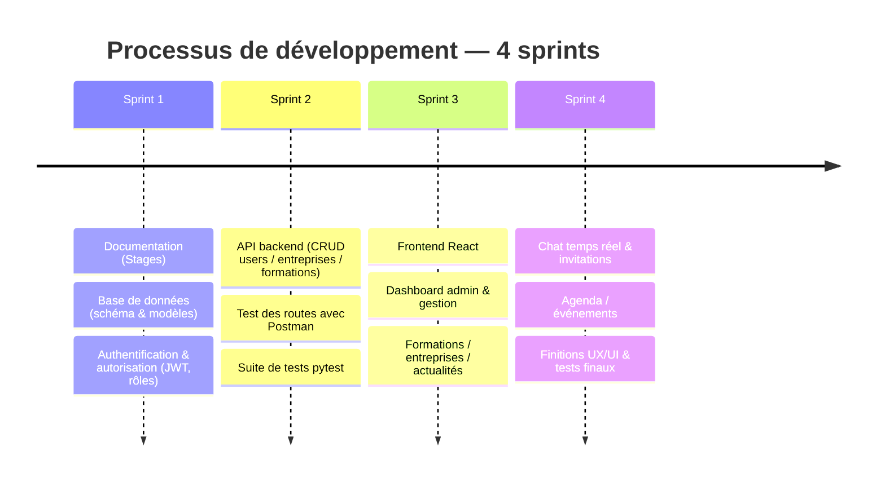

# Deliverables — Portfolio-MDE Dashboard

> **Projet** : tableau de bord de gestion pour une *Maison De l'Entreprise* (pépinière d'entreprises) — gestion des utilisateurs, entreprises hébergées, formations/sessions, actualités, notifications et messagerie temps réel.
>
> **Stack** : Flask REST API + Socket.IO (backend Python 3.12) · React 18 + Vite (frontend) · SQLAlchemy / Alembic · SQLite (dev) / PostgreSQL (prod) · JWT.
>
> **Équipe** : Tom Vieilledent (backend & API) · Nabil Zinini (frontend & UI) · Florian Roosebeke (intégration, QA, documentation, fullstack).
>
> **Période** : 6 mai 2026 → 5 juillet 2026 · **201 commits** · 4 contributeurs.

---

## 📋 Tableau récapitulatif

| Deliverable | Statut | Lien / Preuve |
| --- | --- | --- |
| Sprint planning | ✅ | [Compte-rendu réunion 25/06/2026](#sprint-planning) |
| Sprint Reviews | ✅ | [Compte-rendu réunion 25/06/2026](#sprint-reviews) |
| Retrospectives | ✅ | [Ajustements post-réunion + historique Git](#retrospectives) |
| Source repository | ✅ | [github.com/tomvieilledent/portfolio-MDE_dashboard](https://github.com/tomvieilledent/portfolio-MDE_dashboard) |
| Bug tracking | ✅ | [GitHub Issues](https://github.com/tomvieilledent/portfolio-MDE_dashboard/issues) |
| Testing evidence and results | ✅ | [340 tests, 100 % passing](#testing-evidence-and-results) |
| Production environment | 🖥️ | [Exécution locale (non déployée)](#production-environment) |

---

## Development process

Le développement a suivi une approche **Agile en 4 sprints** (6 mai → 5 juillet 2026), backend d'abord puis frontend, avec des points d'équipe pour reprioriser le backlog (cf. compte-rendu du 25/06/2026).



| Sprint | Objectifs | Livré |
| --- | --- | --- |
| **Sprint 1** | Documentation · Base de données (schéma) · Authentification & autorisation | Docs techniques (Stages), modèles SQLAlchemy + migrations Alembic, login JWT + rôles/permissions |
| **Sprint 2** | API backend · Test des routes avec Postman | CRUD utilisateurs / entreprises / formations, collection Postman (`postman/`), suite `pytest` |
| **Sprint 3** | Frontend · Dashboard admin · Gestion des contenus | App React (Vite), pages Dashboard / Utilisateurs / Entreprises / Formations / Actualités |
| **Sprint 4** | Messagerie & invitations · Agenda · Finitions | Chat Socket.IO (1-1 + groupes), invitations RSVP, agenda/événements, polish UX/UI, tests finaux (340 tests) |

---

## Roles & responsibilities

L'équipe a combiné des rôles **techniques** et **non-techniques** (Stage 4).

| Rôle | Titulaire | Responsabilités |
| --- | --- | --- |
| **Project Manager (PM)** | Tom Vieilledent | Planification, organisation des sprints, suivi de l'avancement, coordination de l'équipe et arbitrage des priorités (cf. réunion du 25/06). |
| **Quality Assurance (QA)** | Florian Roosebeke | Écriture et exécution des tests (suite `pytest`, 340 tests), intégration, validation de la qualité avant merge, documentation. |
| **Source Control Manager (SCM)** | *Responsabilité partagée* | Pas de rôle SCM formellement nommé ; la gestion du dépôt (centralisation des merges de feature branches, intégration sur `dev`/`main`) a été assurée de fait par Tom, propriétaire du dépôt GitHub. |
| **Développement backend** | Tom Vieilledent | API Flask REST + Socket.IO, modèles, facades, tests backend. |
| **Développement frontend** | Nabil Zinini | Application React (Vite), interface et intégration à l'API. |
| **Fullstack / intégration** | Florian Roosebeke | Intégration frontend↔backend, support transverse, documentation. |

## Collaboration & Git workflow

La collaboration s'est appuyée sur **Git / GitHub** avec un flux **feature-branch → `dev` → `main`** :

- **Branches de fonctionnalités** dédiées par chantier : `feature_chat`, `feature_formations`, `feature_news`, `feature_picture`, `tom-formation_back`, ainsi que des branches par personne (`Nabil`, `dev`).
- **Intégration par merge** : ~19 commits de merge traçant l'assemblage des fonctionnalités sur `dev` puis `main`, avec au moins une **Pull Request** (`Merge pull request #1 from tomvieilledent/feature_news`).
- **Revue de code** : les fonctionnalités étaient relues avant intégration sur les branches partagées (revue par le PM / propriétaire du dépôt).
- **Points d'équipe** : synchronisations régulières et une réunion formelle de revue/planification le **25/06/2026** (compte-rendu versionné dans le repo).
- **Convention de commits** : messages préfixés (`feat:`, `fix:`, `chore:`) sur **201 commits** répartis entre 4 contributeurs.

**Suivi de progression** : l'avancement a été mesuré qualitativement via la complétion des points d'action du backlog (12 items priorisés le 25/06, tous livrés) et le taux de tests au vert (340/340). Les corrections de bugs sont traçables via les commits `fix:`.

---

## Sprint planning

Le projet a été mené en sprints itératifs. La planification du sprint la plus formalisée est le **compte-rendu de réunion d'équipe du 25 juin 2026**, où **12 points d'action** ont été identifiés et priorisés pour le sprint suivant, regroupés par domaine :

- **Messagerie & Communication** — système d'invitation, chat collaboratif multi-utilisateurs (type WhatsApp), meilleure visibilité de la messagerie, correction du bug de notification.
- **Formations & Ateliers** — catégories libres, pièces jointes, renommage « Formations / Ateliers », nouvelle section Ateliers.
- **Espace Entreprises** — nouveaux statuts d'hébergement, groupe « Formateurs ».
- **Landing Page** — nouveau slogan, suppressions de sections, édition dynamique par le super-admin.
- **Gestion & Administration** — comptes super-admin, permissions granulaires.

📎 **Lien** : [`compte-rendu-reunion-25-06-26.html`](https://github.com/tomvieilledent/portfolio-MDE_dashboard/blob/dev/compte-rendu-reunion-25-06-26.html) (branche `dev`)

La priorisation globale suit la méthode **MoSCoW** (Must / Should / Could / Won't) documentée dans les user stories du Stage 3 (`docs/stage3final.md`).

---

## Sprint Reviews

La réunion du **25 juin 2026** (présents : Céline, Nabil Zinini, Tom Vieilledent, Florian Roosebeke) a servi de **Sprint Review** : présentation et démonstration du **Dashboard v1** à l'équipe et au client (Céline), suivie du recueil des retours.

La bonne exécution du sprint planifié est **traçable dans l'historique Git** : les fonctionnalités décidées en réunion ont bien été livrées ensuite (chat collaboratif multi-utilisateurs, système d'invitations restreignant la visibilité des événements/sessions, refonte de la landing page, statuts d'hébergement).

📎 **Lien** : [`compte-rendu-reunion-25-06-26.html`](https://github.com/tomvieilledent/portfolio-MDE_dashboard/blob/dev/compte-rendu-reunion-25-06-26.html) — section « Présentation Dashboard v1 »

📎 **Historique des livraisons** : [Historique des commits](https://github.com/tomvieilledent/portfolio-MDE_dashboard/commits/dev)

---

## Retrospectives

Les rétrospectives ont été menées de façon informelle en fin de réunion : identification de ce qui devait être corrigé/ajusté (renommages d'interface, correction de bugs, suppression de sections superflues de la landing page) et réinjection immédiate dans le backlog du sprint suivant.

Ces ajustements sont **reflétés dans les commits de correction** postérieurs à la réunion. *Aucun outil de rétrospective dédié (type FunRetro) n'a été utilisé ; les décisions sont consignées dans le compte-rendu et l'historique Git.*

📎 **Lien** : [Compte-rendu 25/06/2026](https://github.com/tomvieilledent/portfolio-MDE_dashboard/blob/dev/compte-rendu-reunion-25-06-26.html) + [Historique des commits](https://github.com/tomvieilledent/portfolio-MDE_dashboard/commits/dev)

---

## Source repository

**Dépôt GitHub** : https://github.com/tomvieilledent/portfolio-MDE_dashboard

**Organisation du dépôt** :

- `backend/` — API Flask REST + Socket.IO (architecture en couches : Resource → Service → Facade → ORM)
- `frontend/` — application React 18 + Vite
- `tests/` — suite de tests automatisés (pytest)
- `alembic/` — migrations de base de données
- `docs/` — documentation technique (Stage 3, API overview, maquettes Figma)

**Modèle de branches (SCM)** :

| Branche | Rôle |
| --- | --- |
| `main` | Version stable / production |
| `dev` | Branche d'intégration du développement |
| `feature_*` | Développement de fonctionnalités (`feature_chat`, `feature_formations`, `feature_news`, `feature_picture`…) |

Le travail suit un flux **feature-branch → dev → main** avec des messages de commit conventionnels (`feat:`, `chore:`, `fix:`).

---

## Bug tracking

Le suivi des anomalies est assuré via **GitHub Issues** sur le dépôt, complété par les notes de réunion et l'historique Git :

1. **GitHub Issues** — tracker officiel des bugs et améliorations (avec labels `bug` / `enhancement` / `frontend` / `backend` / `security`). Exemples suivis : crash de l'onglet Logs (`MonOnglet.jsx`), affichage du badge de notification messagerie, persistance de la blocklist JWT.
2. **Le compte-rendu de réunion**, qui a listé explicitement les bugs à corriger — exemple : *« Fix Notification : résoudre le bug d'affichage du point rouge de notification messagerie »*.
3. **Les messages de commit dédiés** (`fix:` / « Fix … ») qui tracent la résolution de chaque anomalie dans l'historique Git.

📎 **Liens** :

- **Bug tracker** → [github.com/tomvieilledent/portfolio-MDE_dashboard/issues](https://github.com/tomvieilledent/portfolio-MDE_dashboard/issues)
- [Commits de correction (recherche `fix`)](https://github.com/tomvieilledent/portfolio-MDE_dashboard/commits/dev)
- [Compte-rendu 25/06/2026](https://github.com/tomvieilledent/portfolio-MDE_dashboard/blob/dev/compte-rendu-reunion-25-06-26.html)

---

## Testing evidence and results

Le backend est couvert par une **suite de tests automatisés pytest** exécutable en une commande. La suite est **entièrement verte**.

### Résultat global

```
$ PYTHONPATH=. pytest -q
........................................................................ [ 21%]
........................................................................ [ 42%]
........................................................................ [ 63%]
........................................................................ [ 84%]
....................................................                     [100%]
340 passed in 167.54s (0:02:47)
```

**➡️ 340 tests · 100 % passing · 0 échec.**

### Répartition par domaine

| Fichier de test | Nb tests | Couverture |
| --- | ---: | --- |
| `test_models.py` | 91 | Validation des modèles domaine (règles métier) |
| `test_api_auth_users_companies_trainings.py` | 58 | Auth JWT, utilisateurs, entreprises, formations |
| `test_facades.py` | 52 | Couche d'accès aux données (CRUD SQLAlchemy) |
| `test_training_sessions_api.py` | 49 | Sessions de formation planifiées |
| `test_api_relations_content.py` | 20 | Relations & contenus |
| `test_invitations_api.py` | 13 | Système d'invitations (visibilité restreinte) |
| `test_saved_news.py` | 9 | Actualités enregistrées |
| `test_events_api.py` | 9 | Agenda / événements |
| `test_chat_sockets.py` | 8 | Messagerie temps réel (Socket.IO) |
| `test_staff_permissions.py` | 7 | Rôle Staff & permissions granulaires |
| `test_contact_and_reset.py` | 7 | Contact & réinitialisation de mot de passe |
| `test_company_kind.py` | 7 | Typologie d'entreprises |
| `test_agenda_export.py` | 6 | Export de l'agenda |
| `test_conversation_participant.py` | 2 | Participants de conversation |
| `test_content_api.py` | 2 | API de contenu |
| **Total** | **340** | |

### Reproduire les tests

```bash
source .venv/bin/activate
PYTHONPATH=. pytest                 # suite complète
PYTHONPATH=. pytest -k "chat"       # par mot-clé
PYTHONPATH=. pytest tests/test_events_api.py   # un fichier
```

Les tests sont isolés : `tests/conftest.py` provisionne une base SQLite temporaire par test et reconstruit le schéma proprement.

---

## Production environment

L'application s'exécute **en local** (non déployée sur un hébergeur public à ce stade).

### Lancer l'environnement

**Backend** (API REST + Socket.IO, port `8000`) :

```bash
source .venv/bin/activate
python -m backend.api.run
```

**Frontend** (Vite, port `3000`) :

```bash
cd frontend
npm install && npm run dev
```

### Points d'accès

| Ressource | URL locale |
| --- | --- |
| Application (frontend) | http://localhost:3000 |
| API backend | http://localhost:8000 |
| Documentation Swagger UI | http://localhost:8000/ (aussi `/docs`, `/swagger`) |
| Spécification OpenAPI | http://localhost:8000/openapi.json |
| Health check | http://localhost:8000/status |

### Prêt pour la production

- **Base de données** : SQLite en dev, **PostgreSQL** en prod (`psycopg2-binary` installé, `DATABASE_URL` configurable).
- **Migrations** : Alembic (`alembic upgrade head`).
- **Configuration** : variables d'environnement (`.env`) — `JWT_SECRET_KEY`, `DATABASE_URL`, SMTP.
- **Temps réel** : lancement via `backend.api.run` (`socketio.run`) pour le support WebSocket.

---

## Annexe — Périmètre fonctionnel livré

| Domaine | Endpoints API | Fonctionnalités |
| --- | --- | --- |
| Authentification | `auth` | Login JWT, logout (blocklist), reset password |
| Utilisateurs | `user` | CRUD, rôles, Staff + permissions granulaires |
| Entreprises | `company` | Profils, statuts d'hébergement, « Mon entreprise » |
| Formations | `training`, `training_session`, `formation_user` | Catalogue, sessions planifiées, inscriptions |
| Agenda | `event` | Événements avec visibilité restreinte aux invités |
| Invitations | `invitation` | Invitations événements/sessions |
| Actualités | `news` | Publication + sync RSS horaire (feedparser + APScheduler) |
| Notifications | `notification` | Système de notifications |
| Messagerie | `conversation`, `message` | Chat temps réel 1-1 et **groupes multi-utilisateurs** (Socket.IO) |
| Contact / Export | `contact`, `export` | Formulaire de contact, exports de données |

**Frontend** (React) : Landing page, Dashboard, Utilisateurs, Formations, Entreprises, Gestion, Mon entreprise, Actualités, panneau de chat temps réel (`socket.io-client`).
