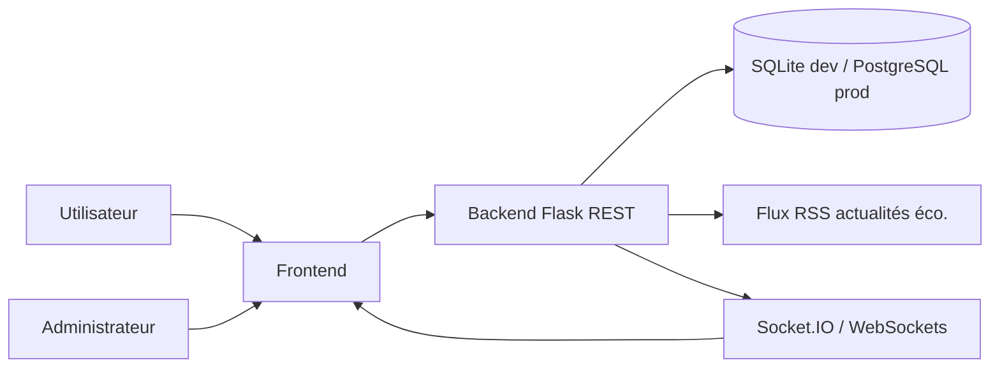
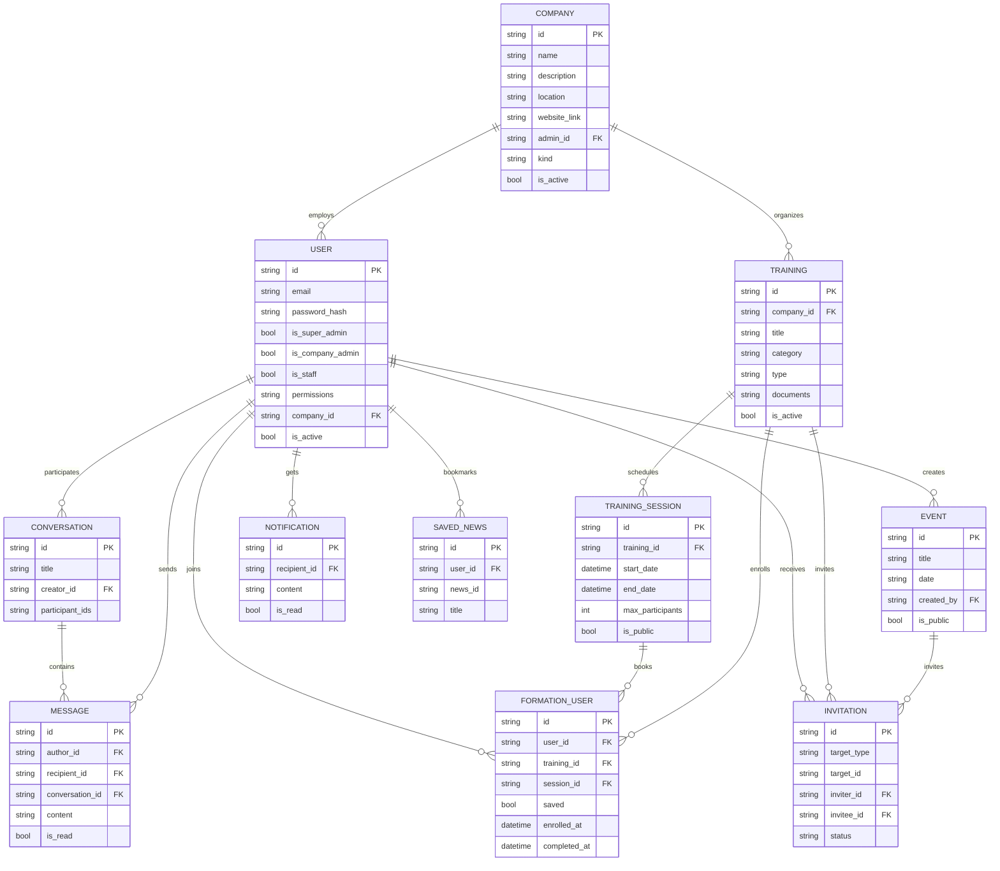
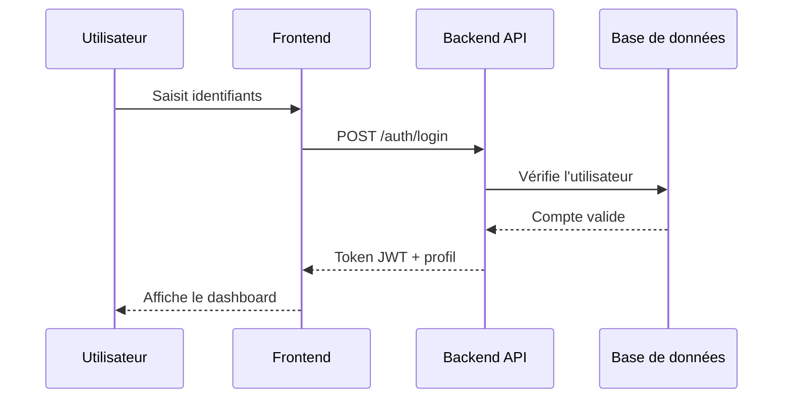
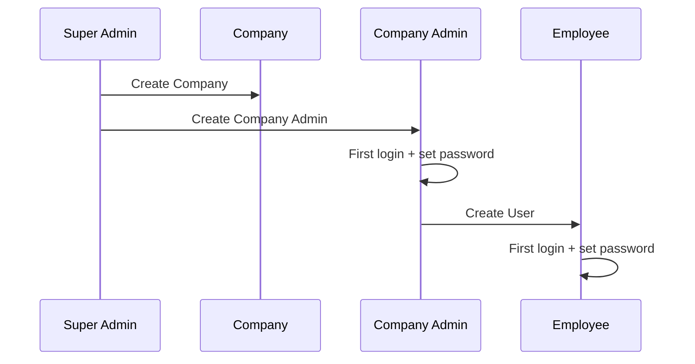
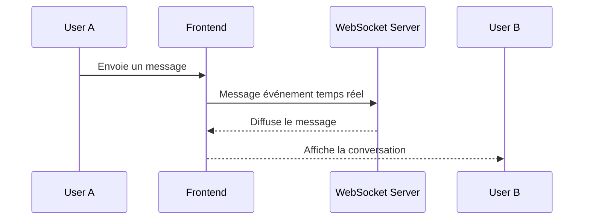

# Stage 3 — Documentation Technique

## 1. User Stories

La méthode de priorisation retenue est **MoSCoW**.

| Priorité    | User Story                                                                                                                  |
| ----------- | --------------------------------------------------------------------------------------------------------------------------- |
| Must Have   | En tant qu’utilisateur, je veux me connecter de manière sécurisée afin d’accéder à mon espace personnel.                    |
| Must Have   | En tant qu’utilisateur, je veux consulter l’annuaire des entreprises et des employés afin d’identifier les contacts utiles. |
| Must Have   | En tant qu’employé, je veux consulter les formations disponibles afin de progresser.                                        |
| Must Have   | En tant qu’utilisateur, je veux envoyer et recevoir des messages afin d’échanger avec d’autres membres.                     |
| Must Have   | En tant qu’utilisateur, je veux consulter des actualités économiques afin de rester informé.                                |
| Must Have   | En tant qu’administrateur, je veux gérer les utilisateurs et les entreprises afin d’administrer la plateforme.              |
| Should Have | En tant qu’utilisateur, je veux rechercher rapidement un contenu afin de gagner du temps.                                   |
| Should Have | En tant qu’utilisateur, je veux modifier mon profil afin de garder mes informations à jour.                                 |
| Could Have  | En tant qu’utilisateur, je veux recevoir des notifications pour les événements importants afin de ne rien manquer.          |
| Could Have  | En tant qu’administrateur, je veux consulter des statistiques d’usage afin de suivre l’adoption du produit.                 |
| Won’t Have  | En tant qu’utilisateur, je veux une application mobile native afin d’utiliser la plateforme sur téléphone.                  |

## 2. Maquette

<table>
  <tr>
    <td></td>
    <td></td>
    <td></td>
  </tr>
  <tr>
    <td></td>
    <td></td>
    <td></td>
  <tr>
</table>

## 3. Architecture du système

L’architecture retenue dans la documentation est une architecture web classique avec séparation claire entre frontend, backend, base de données et temps réel.



### 3.1 Choix d’architecture

- **Frontend** : React 18 + Vite ; navigation par état d’onglet (`Dashboard.jsx`), sans `react-router`.
- **Backend** : API REST Flask (Flask-RESTful) en couches strictes `Resource → Service → Facade → ORM`.
- **Base de données** : SQLAlchemy avec **SQLite en développement** et **PostgreSQL en production** (`psycopg2-binary`, `DATABASE_URL`) ; migrations gérées par **Alembic**.
- **Temps réel** : **Socket.IO** (Flask-SocketIO) pour la messagerie et la présence.
- **Sécurité** : authentification **JWT** (`flask_jwt_extended`) et contrôle d’accès par rôle et permissions.
- **Tâches de fond** : APScheduler synchronise chaque heure des flux **RSS** d’actualités économiques françaises (`feedparser`).

## 4. Composants, classes et modèle de données

Les tables de persistance effectivement livrées (`backend/persistence/models.py`) sont :

- utilisateurs (`users`),
- entreprises (`companies`),
- formations / ateliers (`trainings`),
- sessions de formation (`training_sessions`),
- inscriptions & favoris (`formation_users`),
- conversations et messages (`conversations`, `messages`, `conversation_participants`),
- notifications (`notifications`),
- actualités et actualités enregistrées (`news`, `saved_news`),
- événements d’agenda (`events`),
- invitations (`invitations`),
- contenu de site éditable (`site_content`).

### 4.1 Entités principales

- **User** (`users`) : UUID, **email** (identifiant de connexion, unique), `password_hash`, profil (`first_name`, `last_name`, `job_title`, `phone`, `profile_picture`, `business_card`), rôles `is_super_admin` / `is_company_admin` / `is_staff` avec `permissions` (CSV de droits granulaires), `company_id`, statut `is_active`, champs d’audit.
- **Company** (`companies`) : UUID, `name`, `description`, `location`, `website_link`, `company_picture`, `admin_email`/`admin_id`, `kind` (`company` = entreprise hébergée / `trainer` = formateur), statut et audit.
- **Training** (`trainings`) : UUID, `title`, `description`, `picture`, `category` (texte libre), `type` (`formation` / `atelier`), `documents` (pièces jointes en CSV), statut et audit.
- **TrainingSession** (`training_sessions`) : session planifiée d’une formation — `training_id`, `start_date`, `end_date`, `max_participants`, `location`/`link`, `status`, `is_public`.
- **FormationUser** (`formation_users`) : lien user ↔ formation/session — inscription (`enrolled_at`, `completed_at`) **ou** favori (`saved`), avec `type`.
- **Conversation** (`conversations`) : salon 1-1 ou groupe nommé — `title` (groupe), `creator_id`, `participant_ids` (CSV, source de vérité des membres).
- **Message** (`messages`) : `author_id`, `recipient_id` **ou** `conversation_id`, `content`, `is_read`.
- **Notification** (`notifications`) : `recipient_id`, `content`, `is_read`.
- **News** / **SavedNews** : article normalisé (source, url, résumé, `published_at`) ; `saved_news` est un signet par utilisateur (snapshot autoporté, unicité `user_id`+`news_id`).
- **Event** (`events`) : `title`, `date`/`time` (chaînes), `color`, `creator`/`created_by`, `is_public` (sinon visible sur invitation).
- **Invitation** (`invitations`) : invitation RSVP à un `event` ou une `training` (`target_type`/`target_id`), `inviter_id`, `invitee_id`, `status` (`pending`/`accepted`/`declined`).
- **SiteContent** (`site_content`) : blocs de contenu éditables (ex. `landing`), `value` en JSON.

#### Conventions communes (pas de `BaseClass` héritée)

Il n’existe **pas** de super-classe `BaseClass` : chaque modèle hérite du `Base` déclaratif de SQLAlchemy et répète les colonnes utiles. Les conventions partagées sont :

- **clé primaire** : `id` en `String(36)`, UUID généré (`default=lambda: str(uuid.uuid4())`) ;
- **horodatage** : `created_at` (et `updated_at` sur les tables mutables) ;
- **suppression douce (soft delete)** : les tables cœur (`users`, `companies`, `trainings`) portent `is_active`, `deactivate_by`, `delete_by` au lieu d’être supprimées physiquement.

Les champs d’audit ne sont donc présents que sur les entités qui en ont besoin, pas uniformément sur toutes les tables.

### 4.2 Diagramme ER



> Note : les membres d’une conversation sont stockés dans la colonne CSV `participant_ids` (source de vérité) ; la table `conversation_participants` existe mais reste dormante, conservée pour une migration future.

### 4.3 Règles de conception

- un utilisateur appartient à une seule entreprise principale,
- une formation peut avoir plusieurs inscrits,
- une inscription ne doit pas être dupliquée,
- les messages doivent être traçables,
- les données doivent être filtrées par périmètre de visibilité.

## 5. Diagrammes de séquence

Les séquences de haut niveau documentent les interactions principales du système.

### 5.1 Connexion et accès au dashboard



### 5.2 Création d’une entreprise et activation des comptes



### 5.3 Messagerie temps réel



## 6. Spécifications API

### 6.1 API externes

La veille économique est alimentée par des **flux RSS** d’actualités business françaises, agrégés côté backend avec **`feedparser`** (`backend/services/news_sync.py:sync_all`). La synchronisation tourne automatiquement **toutes les heures** via un `BackgroundScheduler` APScheduler (désactivé en test), et peut aussi être déclenchée manuellement via `POST /news/sync`.

Traitement :

- récupérer les articles depuis les flux RSS sources,
- normaliser les champs (titre, source, résumé, url, catégorie, `published_at`),
- purge glissante sur un mois (les signets `saved_news` conservent un snapshot autoporté).

### 6.2 API internes — Endpoints CRUD détaillés

Conventions réellement en vigueur :

- **Authentification** : jeton **JWT Bearer** (`Authorization: Bearer <token>`) sur les routes privées, via le wrapper `jwt_required` de `backend/api/jwt_helpers.py`. Le logout ajoute le JTI à une **blocklist en mémoire** (non persistée entre redémarrages).
- **Identifiants** : UUID en `String(36)`.
- **Codes de réponse** : `200` (OK), `201` (Created), `204` (No Content), `400`, `401`, `403`, `404`, `409`, `422`, `500`.
- **Erreurs normalisées** : toutes les erreurs passent par `backend/api/errors.py` → `error_response(ERROR_CODES[...], msg, status)` (forme `{ error: { code, message } }`), pas par des `abort` bruts.
- **Suppression douce** : sur les tables cœur, la suppression marque `is_active=false` et renseigne `deactivate_by` / `delete_by`.
- **Documentation vivante** : le contrat complet (méthodes HTTP, corps, réponses) est exposé via **Swagger UI** sur `/` (`/docs`, `/swagger`) et la spec brute sur `/openapi.json`.

> Remarque : la pagination `?page/per_page`, le tri `?sort`, le rate limiting et le format `problem+json` (RFC 7807) décrits dans les versions antérieures de ce document **ne sont pas** implémentés dans la version livrée ; ils restent des pistes d’évolution.

> Les routes ci-dessous sont celles réellement enregistrées dans `backend/api/app.py`.

#### Authentification (`/auth`)

- `POST /auth/register` — Crée un compte utilisateur.
- `POST /auth/login` — Retourne un access token JWT (+ refresh token).
- `POST /auth/refresh` — Rafraîchit l’access token.
- `POST /auth/logout` — Ajoute le JTI courant à la blocklist en mémoire.
- `POST /auth/forgot-password` — Déclenche l’envoi d’un e-mail de réinitialisation.
- `POST /auth/reset-password` — Réinitialise le mot de passe via jeton.

#### Utilisateurs (`/users`)

- `GET`/`POST /users` — Liste / création d’utilisateurs (admin, filtré par périmètre entreprise).
- `GET /users/me` (alias `/me`) — Profil de l’utilisateur courant.
- `GET`/`PATCH`/`DELETE /users/{id}` — Détail, mise à jour, suppression douce.
- `POST /users/{id}/deactivate` · `POST /users/{id}/reactivate` — Désactivation / réactivation.
- `PATCH /users/{id}/role` — Modifie les rôles (super-admin).
- `PATCH /users/{id}/permissions` — Ajuste les permissions granulaires du Staff.
- `PATCH /users/{id}/company-admin` — (Dé)signe un administrateur d’entreprise.
- `POST /users/{id}/reset-password` — Réinitialise le mot de passe (admin).

#### Entreprises (`/companies`)

- `GET`/`POST /companies` — Liste / création (`kind` = `company` ou `trainer`).
- `GET`/`PATCH`/`DELETE /companies/{id}` — Détail, mise à jour, suppression douce.
- `POST /companies/{id}/deactivate` · `POST /companies/{id}/reactivate` — Désactivation / réactivation.
- `GET /companies/{id}/users` — Utilisateurs rattachés à l’entreprise.
- `POST /companies/{id}/assign-user` — Rattache un utilisateur à l’entreprise.

#### Formations / Ateliers (`/trainings`)

- `GET`/`POST /trainings` — Catalogue / création (`type` = `formation`/`atelier`, `category` libre).
- `GET`/`PATCH`/`DELETE /trainings/{id}` — Détail, mise à jour, suppression douce.
- `POST /trainings/{id}/document` — Ajoute une pièce jointe (plaquette numérisée…).
- `POST /trainings/{id}/interest` · `GET /trainings/{id}/interested` — Marque / liste les intéressés.
- `POST /trainings/{id}/saved` — (Dé)favorise une formation.
- `GET /trainings/{id}/enrollments` — Liste des inscrits.
- `GET /trainings/{id}/sessions` — Sessions planifiées d’une formation.
- `GET /trainings/completions` — Formations complétées.
- `GET /users/{id}/trainings` — Formations d’un utilisateur ; `GET /me/trainings`, `GET /me/saved-trainings` pour l’utilisateur courant.

#### Sessions de formation (`/training-sessions`)

- `GET`/`POST /training-sessions` — Liste / création d’une session (`start_date`, `end_date`, `max_participants`, `is_public`).
- `GET`/`PATCH`/`DELETE /training-sessions/{id}` — Détail, mise à jour, suppression.
- `POST /training-sessions/{id}/enroll` — Inscription à une session.

#### Inscriptions & favoris (`/formation-users`)

- `GET`/`POST /formation-users` — Liste / création d’un lien user ↔ formation/session (inscription ou favori).
- `GET`/`PATCH`/`DELETE /formation-users/{id}` — Détail, mise à jour, suppression.

#### Messagerie et Conversations

Modèle : une `Conversation` (1-1 ou groupe nommé) contient des `Message`. Les membres sont dans la colonne CSV `participant_ids`.

- `GET`/`POST /conversations` (alias `/rooms`) — Liste / création d’une conversation (`title?`, `participant_ids`).
- `GET`/`PATCH`/`DELETE /conversations/{id}` — Détail, renommage / (dé)ajout de membres (créateur), départ.
- `GET`/`POST /conversations/{id}/messages` — Liste / envoi de messages dans la conversation.
- `POST /conversations/{id}/read` — Marque la conversation comme lue.
- `GET /messages` — Messages de l’utilisateur ; `GET /messages/direct/{user_id}` — fil direct avec un utilisateur.
- `GET /messages/unread` — Compteur de non-lus ; `POST /messages/{id}/read` — marque un message lu.
- `DELETE /messages/{id}` — Supprime (soft delete) un message.
- `GET /presence` — État de présence des utilisateurs.

**Temps réel (Socket.IO, pas de route REST `WS`)** — Le client se connecte avec `{ token }` dans l’`auth`. Événements serveur/clients : `connect`/`disconnect`, `join_conversation` → `joined_conversation`, `leave_conversation` → `left_conversation`, `send_message` → `new_message`, `typing`, `mark_read` → `messages_read`, `who_is_online` → `online_users`, `presence`, plus notifications applicatives (`invitation`, `conversation_added`/`_updated`/`_removed`, `message_deleted`). La participation est vérifiée côté serveur avant `join`/`send`.

#### Notifications (`/notifications`)

- `GET`/`POST /notifications` — Liste / création d’une notification pour l’utilisateur.
- `PATCH`/`DELETE /notifications/{id}` — Marquer lue / supprimer.

#### Actualités / Veille (`/news`)

- `GET /news` — Articles normalisés (source, `published_at`, catégorie).
- `GET /news/{id}` — Détail d’un article.
- `POST /news/sync` — Déclenche la synchronisation des flux RSS (aussi lancée toutes les heures par APScheduler).
- `GET`/`POST /news/saved` · `GET`/`DELETE /news/saved/{id}` — Signets d’articles par utilisateur.

#### Agenda / Événements (`/events`)

- `GET`/`POST /events` — Liste / création d’un événement (`date`, `time`, `is_public`).
- `GET`/`PATCH`/`DELETE /events/{id}` — Détail, mise à jour, suppression douce.

#### Invitations (`/invitations`)

- `GET`/`POST /invitations` — Liste / création d’invitations RSVP à un `event` ou une `training`.
- `GET /me/invitations` — Invitations reçues par l’utilisateur courant.
- `GET`/`PATCH`/`DELETE /invitations/{id}` — Détail, réponse (`accepted`/`declined`), suppression.

#### Contenu, contact & exports

- `GET`/`PATCH /content/{key}` — Blocs de contenu éditables (ex. `landing`, valeur JSON).
- `POST /contact` — Envoi du formulaire de contact (e-mail SMTP).
- `GET /exports/monthly` — Export mensuel de l’agenda (événements/sessions publics).

### 6.3 Formats d’entrée et de sortie

Exemples (abrégés):

Create User

```json
{
  "first_name": "Guillaume",
  "last_name": "Salva",
  "email": "guillaume@example.com",
  "password": "secret",
  "company_id": "uuid-company"
}
```

Create Company

```json
{
  "name": "Acme Corp",
  "description": "Société",
  "website_link": "https://acme.example"
}
```

Create Training

```json
{
  "title": "Gestion de projet",
  "description": "Formation de base",
  "company_id": "uuid-company"
}
```

Create Message

```json
{
  "content": "Bonjour",
  "conversation_id": "uuid-conversation"
}
```

Create Enrollment

```json
{
  "user_id": "uuid-user",
  "training_id": "uuid-training"
}
```

### 6.4 Contraintes de sécurité API

**Implémenté :**

- authentification obligatoire sur les routes privées (JWT Bearer via `jwt_required`),
- contrôle d’accès par rôle et permissions granulaires (`is_super_admin` / `is_company_admin` / `is_staff` + `permissions`), avec application `_can()`,
- filtrage des données par entreprise pour limiter les fuites multi-tenant,
- validation des entrées via les **modèles de domaine** (`backend/models/*.py`) dont les setters lèvent `ValueError`/`TypeError` avant persistance,
- hachage des mots de passe (`werkzeug generate_password_hash`) réalisé dans la couche facade, jamais stocké en clair,
- authentification des connexions Socket.IO par jeton + vérification de participation avant `join`/`send`,
- soft-delete et audit (`deactivate_by`, `delete_by`, timestamps) sur les tables cœur,
- réponses d’erreur normalisées via `backend/api/errors.py` (`{ error: { code, message } }`).

**Pistes d’évolution (non livrées) :**

- rate limiting sur les endpoints sensibles (auth, messages),
- persistance de la blocklist JWT (actuellement en mémoire, perdue au redémarrage),
- journalisation structurée des opérations sensibles.

# 10. Plan SCM (Gestion du code source)

| Élément                  | Explication simple                                                                 |
| ------------------------ | ---------------------------------------------------------------------------------- |
| Dépôt Git                | GitHub : `github.com/tomvieilledent/portfolio-MDE_dashboard`, avec `frontend/` et `backend/` |
| Branche `main`           | Version stable / production                                                       |
| Branche `dev`            | Branche d’intégration du développement                                            |
| `feature_*`              | Branches de fonctionnalités effectivement utilisées (`feature_chat`, `feature_formations`, `feature_news`, `feature_picture`) |
| `release/*` · `hotfix/*` | Convention prévue (non utilisée sur ce projet à ce stade)                         |
| Pull Request             | Chaque modification doit être vérifiée avant d’être ajoutée au projet              |
| Protection des branches  | Impossible de modifier `main` et `dev` sans validation                             |
| Convention des commits   | Messages de commits écrits de manière claire et organisée                          |
| Vérification automatique | Le code est testé automatiquement avant validation                                 |
| Outils qualité           | Utilisation d’outils pour formater et vérifier le code                             |
| Mise à jour dépendances  | Dépendances mises à jour automatiquement                                           |
| Changelog                | Historique des modifications généré automatiquement                                |
| Documentation            | Fichier expliquant comment est pensé le projet                                     |
| Gestion des secrets      | Les mots de passe et clés API ne sont jamais stockés dans le code                  |
| CI parallèle             | Plusieurs tests lancés en même temps pour gagner du temps                          |

## Répartition des tâches

| Personne | Rôle                                                |
| -------- | --------------------------------------------------- |
| Tom      | Développement backend et API                        |
| Nabil    | Développement frontend et interface utilisateur     |
| Florian  | Intégration, QA, documentation et support fullstack |

---

# 11. Stratégie QA (Assurance Qualité)

| Domaine               | Explication simple                               |
| --------------------- | ------------------------------------------------ |
| Objectif QA           | Assurer un projet fiable, sécurisé et rapide     |
| Tests unitaires       | Vérification des fonctions importantes du projet |
| Tests E2E             | Simulation des actions utilisateur importantes   |
| Tests de performance  | Vérification que l’application reste rapide      |
| Objectif performance  | Temps de réponse API inférieur à 500 ms          |
| Sécurité              | Détection automatique des failles de sécurité    |
| Observabilité         | Surveillance des erreurs et performances         |
| Alertes               | Notification en cas de problème serveur          |
| Environnement staging | Version de test proche de la production          |
| Accessibilité         | Vérification que le site est utilisable par tous |
| Sauvegardes           | Sauvegarde régulière de la base de données       |
| Rollback              | Possibilité de revenir à une ancienne version    |
| Smoke tests           | Vérification rapide après chaque déploiement     |
| Priorité qualité      | Importance donnée à des tests utiles et fiables  |

---

# Pipeline CI/CD simplifié

| Étape | Action                    |
| ----- | ------------------------- |
| 1     | Vérification du code      |
| 2     | Exécution des tests       |
| 3     | Création du build         |
| 4     | Vérification sécurité     |
| 5     | Déploiement en staging    |
| 6     | Validation finale         |
| 7     | Déploiement en production |

### 11.1 Stratégie de test

La QA repose sur une **suite de tests automatisés `pytest`** couvrant le backend : **340 tests, 100 % passing** (`PYTHONPATH=. pytest`). Les tests sont isolés (`tests/conftest.py` provisionne une base SQLite temporaire par test et reconstruit le schéma).

Principes appliqués :

- développement itératif, cas d’usage critiques couverts en priorité (auth, permissions, CRUD, chat Socket.IO, invitations),
- tests aux différentes couches : modèles de domaine (validation), facades (accès données), et API (résources) ;
- revue des bugs avant chaque validation client (cf. compte-rendu du 25/06/2026),
- documentation des incidents et des corrections via les messages de commit (`fix:`).

> Les tests E2E, tests de performance, environnement de staging et l’observabilité décrits ci-dessus sont des **objectifs de la stratégie QA**, non implémentés dans la version livrée. Aucun test frontend Jest n’est en place ; la couverture automatisée porte sur le backend Python.

## 12. Justifications techniques

Les décisions techniques sont justifiées par les besoins métiers documentés dans les stages précédents :

- centraliser l’information et la communication,
- livrer un MVP atteignable en 12 semaines,
- supporter le temps réel pour la messagerie,
- conserver une structure simple et maintenable,
- faciliter la montée en charge future,
- sécuriser les accès par entreprise et par rôle,
- permettre une validation régulière avec le client.

## 13. Conclusion

La Stage 3 formalise la préparation technique du projet Portfolio-MDE Dashboard (Maison De l'Entreprise). Elle synthétise les besoins métier, le scope MVP, les risques, les choix d’architecture et les exigences de qualité pour servir de base au développement.